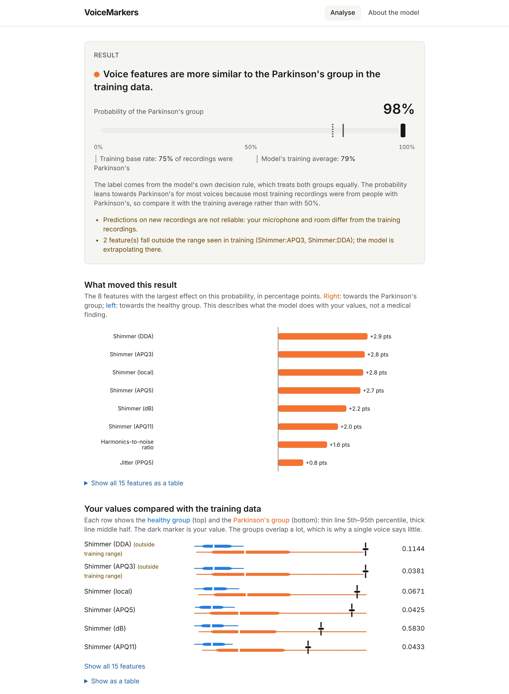
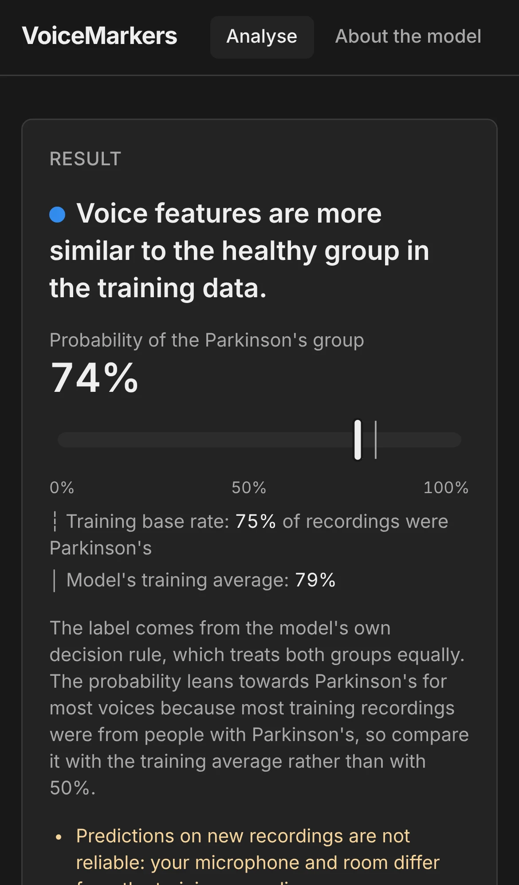
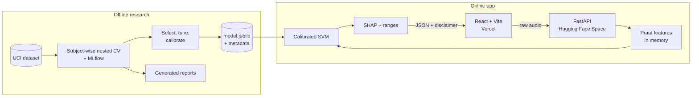

# VoiceMarkers

**What can a sustained "aaah" tell a machine-learning model about Parkinson's disease, and
how far can you trust the answer?**

VoiceMarkers turns my ICOIICS 2025 paper on voice-based Parkinson's detection into a
full-stack app, then re-checks the paper's own numbers more strictly:

1. **Record** a 4-second "aaah" in the browser, **upload** a WAV, or **try a sample**.
2. The backend measures pitch, jitter, shimmer and voice clarity with **Praat** (via Parselmouth).
3. A model trained on the UCI Parkinson's dataset returns a probability, explains which
   features drove it (SHAP), and shows where each value sits relative to both training groups.

**Live demo:** <https://voice-markers.vercel.app> · **API:** <https://arora2006-voicemarkers-api.hf.space/docs>

> **Disclaimer.** VoiceMarkers is a research and education demo. It is **not a medical
> device** and does not diagnose, screen for or rule out Parkinson's disease or any other
> condition. Predictions on new recordings are not reliable. Do not use it to make health
> decisions. Audio is processed in memory and never stored.

<p align="center">
  
  
</p>

## Headline result

The paper reported **87.18% accuracy**. That figure is reproducible, but it comes from a
*row-level* split: recordings of the same person were in both training and test, so a model
can score well by recognising the **speaker**. Tested on **new people** (subject-wise
cross-validation), performance falls to roughly **60–65% balanced accuracy**, where 50% is
chance.

<!-- evaluation-table:start (generated by research/report.py) -->
| Evaluation | Accuracy | Balanced accuracy |
|---|---|---|
| Paper: SVM, one random 80/20 split (row-level) | 87.18% | not reported |
| SVM, same setup over 200 random splits (row-level) | 87.7% ± 4.9% | 75.8% ± 8.2% |
| SVM, subject-wise nested CV, all 22 features | 69.7% ± 13.8% | 64.7% ± 17.5% |
| **Deployed SVM**, subject-wise, 15 audio features | 64.1% ± 13.8% | **64.1% ± 16.8%** |
| Always predict "Parkinson's" (baseline) | 75.6% ± 6.7% | 50.0% ± 0.0% |
<!-- evaluation-table:end -->

_Mean ± std over test folds. Generated by `research/report.py` from the evaluation runs (also
logged to MLflow); not typed by hand._ Full details are in the
[evaluation report](docs/evaluation.md), and the [limitations](docs/limitations.md) explain
why the deployed model is a **demonstration of the method and its limits, not a working
detector**.

## Architecture



Each design decision and the reason for it (subject-wise splits, nested CV, why only 15
features, calibration, label rule, keeping audio in memory) is in
**[docs/architecture.md](docs/architecture.md)**.

## Tech stack

| Layer | Tools |
|---|---|
| ML and research | Python 3.11, scikit-learn, pandas, NumPy, SHAP, MLflow, matplotlib |
| Audio | Parselmouth (Praat), librosa, soundfile, ffmpeg |
| Backend | FastAPI, Pydantic, Uvicorn |
| Frontend | React, Vite, TypeScript, Tailwind CSS, Recharts |
| Testing | pytest + FastAPI test client, Vitest + Testing Library, headless-browser checks with Playwright |
| Delivery | Docker, docker-compose, GitHub Actions, Hugging Face Spaces, Vercel |

## Quick start

Requires Python 3.11, Node 22 and ffmpeg (for browser recordings).

```bash
python3.11 -m venv .venv && source .venv/bin/activate
pip install -e "backend[dev]" -r research/requirements.txt
python -m data.download                 # fetch and verify the UCI dataset
cd backend && uvicorn app.main:app --reload    # http://localhost:8000/docs
```

```bash
cd frontend && npm install && npm run dev      # http://localhost:5173
```

Or run both with Docker: `cp .env.example .env && docker compose up --build`.

### Reproduce the research

```bash
python -m research.reproduce_paper                     # M1: row-level reproduction (~1 min)
python -m research.evaluate                            # M2: subject-wise nested CV (~7 min)
python -m research.evaluate --features reproducible    # M3: same, 15 audio features
python -m research.feature_validation                  # M3: extracted features vs dataset
python -m research.train_final                         # M3: train + save the deployed model
python -m research.report                              # regenerate reports and README table
```

### Tests and checks

```bash
pytest                              # backend, research, deploy (pytest)
cd frontend && npm test             # frontend (Vitest)
pre-commit run --all-files          # ruff, black, prettier
```

CI runs all of these on every push and pull request. It also builds the production Docker
image and smoke-tests it (health check, WAV and WebM predictions, non-root user), and
**deploys automatically on merge to `main`**. See [docs/deployment.md](docs/deployment.md).

## API

| Endpoint | Purpose |
|---|---|
| `POST /predict/audio` | Raw audio as the request body (WAV, FLAC, OGG, or browser WebM/MP4) → features, probability, label, SHAP contributions, feature ranges |
| `POST /predict/features` | `{"features": {...}}` with the 15 feature values → same response |
| `GET /model/info` | Model type, version, training date, features, nested-CV metrics, limitations |
| `GET /health` | Liveness, model status, deployed build |

```bash
curl -X POST --data-binary @data/samples/synthetic_steady.wav \
  -H "Content-Type: audio/wav" http://localhost:8000/predict/audio
```

Every response, including errors, carries the disclaimer. Prediction endpoints are limited
to 10 requests per minute per client.

## Project structure

```
research/   paper reproduction, subject-wise evaluation, feature validation, training, reports
data/       dataset download (UCI, hash-checked) and synthetic sample generator
backend/    FastAPI app: audio/ (decode, validate, Praat features), ml/ (model, SHAP), api/
frontend/   React app: pages, recorder hook, charts, typed API client
deploy/     Hugging Face Space deploy script
docs/       evaluation report, architecture, limitations, deployment guide
```

## Limitations

In short: 32 subject IDs (8 healthy) is very little data; honest performance on new people
is modest; the app computes features with Praat while the dataset used MDVP; seven
nonlinear features can't be reproduced; and microphones and rooms differ from the training
recordings. Details: **[docs/limitations.md](docs/limitations.md)**.

## Citation

**Paper:** Arora, S. *Voice-based Parkinson's disease detection using machine learning.*
ICOIICS 2025. _(Full citation and link to be added.)_

**Dataset:** UCI Parkinson's dataset, licensed
[CC BY 4.0](https://creativecommons.org/licenses/by/4.0/); fetched by `data/download.py`,
never committed or edited.

> Little, M. A., McSharry, P. E., Roberts, S. J., Costello, D. A. E. and Moroz, I. M.
> (2007). Exploiting Nonlinear Recurrence and Fractal Scaling Properties for Voice
> Disorder Detection. *BioMedical Engineering OnLine* 6:23.
> <https://archive.ics.uci.edu/dataset/174/parkinsons>

The demo's sample recordings are **synthetic** (generated by `data/make_samples.py`), not
human voices.

---

**Disclaimer:** research and education demo only. Not a medical device; not for diagnosis or
health decisions.
