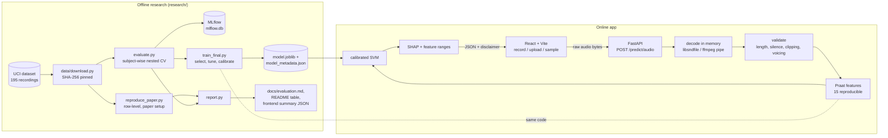

# Architecture

VoiceMarkers has two halves:

- **Offline research pipeline:** turns the UCI dataset into evaluation reports and one
  saved model.
- **Online app:** a FastAPI backend and a React frontend that use that model on a new
  recording.

They share one piece of code, the audio feature extractor, so the features the model was
evaluated on are computed exactly the same way at prediction time.

## Request flow (`POST /predict/audio`)

1. **Browser:**
   - records about 4 s with `MediaRecorder` (WebM in Chrome and Firefox, MP4 in Safari),
     or takes an uploaded file or a bundled sample;
   - sends the bytes as the raw request body, with the format in `Content-Type`.
2. **Rate limit:** 10 requests per minute per client IP, counted in memory. Behind a
   proxy, the IP is taken from the trusted end of `X-Forwarded-For` (`FORWARDED_HOPS`).
3. **Read the body** into memory, capped at 5 MB (413 if larger).
4. **Decode** (`app/audio/load.py`):
   - WAV, FLAC and OGG are read directly by libsndfile;
   - anything else is converted by ffmpeg through stdin/stdout pipes;
   - the result is mixed to mono and resampled to 44.1 kHz, like the training recordings.
5. **Validate** (`app/audio/validate.py`): rejects audio that is shorter than 1.5 s or
   longer than 10 s, silent, clipped, or not a sustained voiced sound. Each case has a
   stable error code and a message written for the person who recorded it.
6. **Extract features** (`app/audio/features.py`): trims 0.25 s from each end, then
   computes 15 features with Praat (via Parselmouth): pitch, 5 jitter, 6 shimmer and HNR.
7. **Predict** (`app/ml/model.py`): the calibrated probability, plus a label from the
   tuned model's own decision.
8. **Explain** (`app/ml/explain.py`, `app/ml/ranges.py`):
   - KernelSHAP contributions measured against 50 reference training rows;
   - where each value falls relative to the healthy and Parkinson's groups.
9. **Respond** with the prediction, contributions, ranges, warnings, the model version,
   the disclaimer and the privacy notice. Errors use the same shape and also carry the
   disclaimer.

## Design decisions and why

| Decision | Why |
|---|---|
| **Subject-wise CV** (`StratifiedGroupKFold` on subject ID) for every new number | Each person has about 6 recordings. A row-level split lets the model recognise the *speaker*, which inflates accuracy. Grouping by subject estimates performance on a *new person*. |
| **Nested CV**: tuning inside each outer training fold, also grouped by subject | Tuning on test folds, or with row-level inner folds, would leak again and overstate performance. |
| **Balanced accuracy** as the headline metric | 75% of recordings are Parkinson's, so always guessing "Parkinson's" already scores about 75% accuracy. |
| **5 folds × 10 repeats** | With only 8 healthy subjects, each test fold holds 1–2 of them, so a single 5-fold run is too noisy to compare models. |
| **Scaling inside a `Pipeline`** | The scaler is fitted on training rows only, so test statistics never leak into training. |
| **Only Praat-reproducible features** in the deployed model | The 7 nonlinear UCI features came from the original authors' code, whose settings aren't published. A model can only use features it can compute from a new recording. |
| **Model choice rule fixed in advance** (logistic regression unless more than one standard error behind) | It avoids picking a winner after seeing the results. The rule chose SVM: logistic regression lost 6 points on the reproducible features. |
| **Platt calibration on subject-wise out-of-fold scores** | An SVM has no probabilities. SVC's built-in `probability=True` calibrates on row-level folds, which leaks. |
| **Label from the model's decision, not probability ≥ 0.5** | The calibrated probability reflects the 75% base rate, so a 0.5 threshold would call almost everyone "Parkinson's-like". The model's own decision is the operating point the reported balanced accuracy describes. |
| **KernelSHAP** for explanations | The deployed model is an RBF SVM, so there are no coefficients to read. KernelSHAP works for any model, takes about 0.15 s per prediction, and its contributions add up exactly to the probability. |
| **Raw request body instead of multipart upload** | Starlette writes multipart uploads over 1 MB to a temporary file on disk. Reading the body into memory keeps the "never stored" promise. |
| **Hand-written rate limiter** | Fixed per-minute windows, about 30 lines, no dependency. It counts per process, which is fine for one free-tier instance. |
| **Generated reports** (`report.py` writes `docs/evaluation.md`, the README table and the frontend's summary JSON) | No result is typed by hand, so the documentation can't drift from the actual runs. |
| **Hugging Face Space for the backend** | Its free tier has 16 GB of RAM. The backend needs about 500 MB with SHAP, numba and Praat, more than the 512 MB some free hosts give. |

## Code map

| Path | Responsibility |
|---|---|
| `data/download.py` | Fetch the UCI CSV, verify its SHA-256 hash and schema |
| `data/make_samples.py` | Deterministic synthetic vowels (demo samples and test inputs) |
| `research/dataset.py`, `models.py`, `metrics.py` | Shared loading, model pipelines and metrics |
| `research/reproduce_paper.py` | M1: row-level reproduction of the paper |
| `research/evaluate.py` | M2/M3: subject-wise nested CV, leave-one-subject-out, permutation importance, MLflow |
| `research/feature_validation.py` | M3: check extracted features against dataset ranges |
| `research/train_final.py` | M3: select, tune, calibrate and save the deployed model and its metadata |
| `research/report.py` | Generate `docs/evaluation.md`, the README table and the frontend summary |
| `backend/app/audio/` | Decode, validate and extract features (used by research and the API) |
| `backend/app/ml/` | Model loading, prediction, SHAP explanations and feature ranges |
| `backend/app/api/` | Routers, schemas, error handlers and dependencies |
| `frontend/src/` | Pages, recorder hook, charts and API client |
| `deploy/deploy_space.py` | Stage and upload the backend to the Hugging Face Space |
| `.github/workflows/ci.yml` | Lint, tests, Docker smoke test, deploys on `main` |
