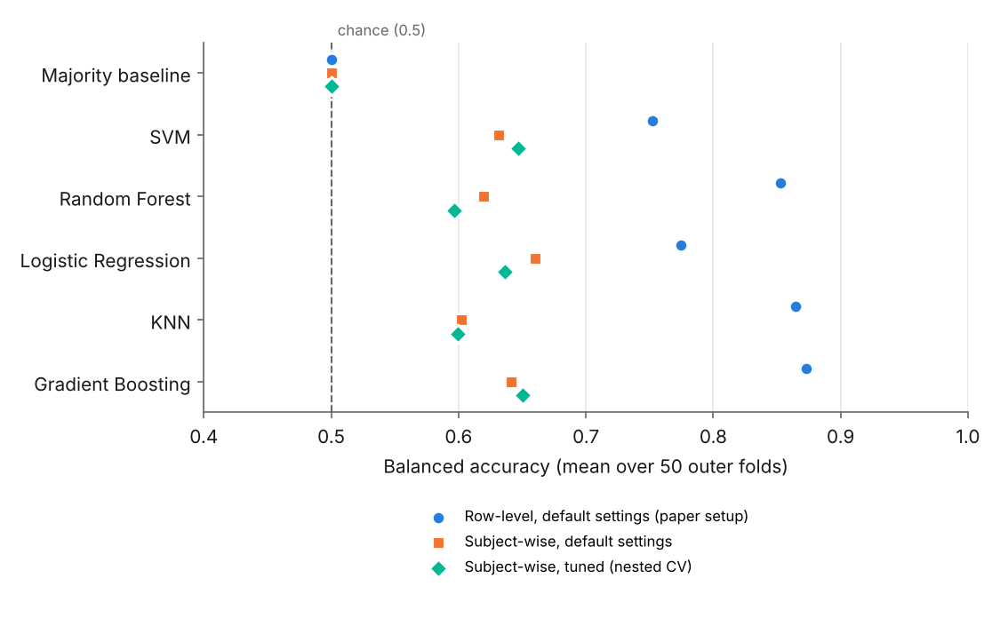
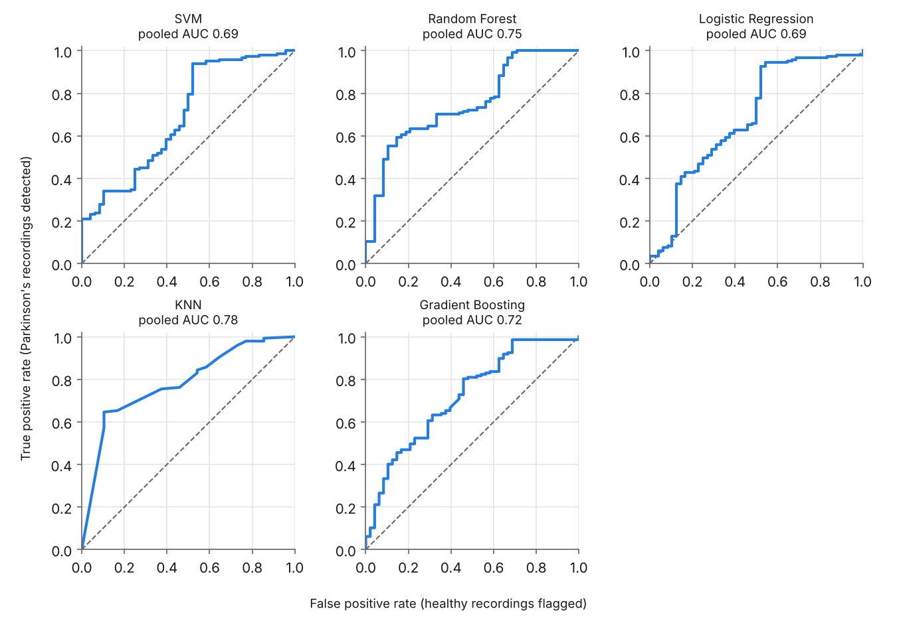

# Evaluation report

_Generated by `research/report.py` from `research/results/*.json` — do not edit by hand.
Regenerate with `python -m research.reproduce_paper && python -m research.evaluate && python -m research.report`._

All runs: scikit-learn 1.9.1; every model is `StandardScaler → classifier`
in one Pipeline, so scaling is fitted on training data only. Parkinson's is the positive
class (recall = sensitivity; specificity = healthy recordings correctly identified).
Each evaluation run is also logged to MLflow (local `mlflow.db`).

## 1. Dataset

- **195 recordings**: 147 Parkinson's (75.4%), 48 healthy.
- **32 subject IDs** parsed from the `name` column: 24 Parkinson's, 8 healthy, with 6–7 recordings each.
- The dataset description says 31 people (23 with Parkinson's), but the file encodes 32 distinct IDs. Subject-wise splits group on the IDs as they appear. If two IDs are in fact one person, a small amount of leakage remains, far less than in a row-level split.
- SHA-256 of the file: `a36116c2deac07895b79ce97a2f99a1b3720ac4892995ff5c3b9ccb397ed2bc5`.

## 2. Majority-class baseline

Always predicting "Parkinson's" scores **75.6% ± 6.7% accuracy** under subject-wise CV, with
50% balanced accuracy, 100% recall and 0% specificity. Any accuracy figure on this dataset
has to be read against that baseline, which is why balanced accuracy is the headline metric below.

## 3. Table 1 — paper reproduction (row-level)

The paper reports 87.18% SVM test accuracy from one stratified 80/20 row-level split (34 of 39 test
recordings). Over 200 random stratified 80/20 splits an SVM with default settings scores 87.9% ± 3.6%,
so the paper's figure is typical for that protocol. The paper also reports 88.46% training accuracy; the default SVM averages 89.9% ± 1.1%, while the grid search the paper describes gives 99.8% ± 0.6% training and 93.2% ± 3.0% test accuracy, so the reported figures match an untuned SVM. Full tables:
[`research/results/paper_reproduction.md`](../research/results/paper_reproduction.md).

| Model | Accuracy, 200 stratified 80/20 splits | 5th–95th pct | Bal. acc. | ROC-AUC |
|---|---|---|---|---|
| Majority baseline | 74.4% ± 0.0% | 74.4% – 74.4% | 50.0% ± 0.0% | 50.0% ± 0.0% |
| SVM | 87.9% ± 3.6% | 82.1% – 92.3% | 76.7% ± 6.9% | 89.0% ± 6.9% |
| Random Forest | 90.9% ± 4.0% | 84.6% – 97.4% | 85.5% ± 6.7% | 96.4% ± 2.7% |
| Logistic Regression | 85.6% ± 4.4% | 79.5% – 92.3% | 78.5% ± 6.8% | 90.4% ± 4.5% |
| KNN | 90.9% ± 4.3% | 84.6% – 97.4% | 87.3% ± 6.4% | 96.6% ± 2.6% |
| Gradient Boosting | 91.5% ± 3.7% | 87.2% – 97.4% | 87.1% ± 5.9% | 96.5% ± 3.3% |

## 4. Table 2 — subject-wise evaluation

Outer CV: `StratifiedGroupKFold`, 5 folds × 10 repeats = 50 test folds per model; no subject is ever in both
the training and test side of a fold. With 8 healthy subjects, each test fold holds only 1–2 of them, hence
the repeats. **Tuned** = settings chosen by an inner 4-fold subject-wise grid search on each outer training set,
scored by balanced accuracy; the outer test fold is never seen during tuning. Mean ± std over the 50 outer folds.

### Table 2a — subject-wise, tuned: all metrics

| Model | Bal. acc. | Accuracy | Precision | Recall | Specificity | F1 | ROC-AUC |
|---|---|---|---|---|---|---|---|
| Majority baseline | 50.0% ± 0.0% | 75.6% ± 6.7% | 75.6% ± 6.7% | 100.0% ± 0.0% | 0.0% ± 0.0% | 86.0% ± 4.3% | 50.0% ± 0.0% |
| SVM | 64.7% ± 17.5% | 69.7% ± 13.8% | 88.0% ± 11.3% | 72.5% ± 22.2% | 56.8% ± 43.4% | 76.5% ± 14.3% | 72.6% ± 25.4% |
| Random Forest | 59.6% ± 16.7% | 73.6% ± 9.8% | 81.7% ± 10.1% | 85.8% ± 13.2% | 33.5% ± 37.1% | 82.7% ± 7.5% | 77.8% ± 16.4% |
| Logistic Regression | 63.6% ± 18.9% | 72.8% ± 13.5% | 85.2% ± 11.0% | 79.8% ± 18.5% | 47.5% ± 41.1% | 80.5% ± 12.1% | 78.6% ± 20.1% |
| KNN | 60.0% ± 14.7% | 75.8% ± 8.4% | 81.0% ± 8.1% | 90.1% ± 9.7% | 29.8% ± 31.5% | 84.7% ± 5.7% | 74.6% ± 17.3% |
| Gradient Boosting | 65.1% ± 16.4% | 79.0% ± 8.8% | 83.4% ± 8.8% | 91.6% ± 8.3% | 38.5% ± 33.5% | 86.8% ± 5.6% | 74.0% ± 17.3% |

### Table 2b — row-level vs subject-wise, on the same models

Same outer fold scheme for all three columns, so the first gap is the leakage effect and the second
is what tuning adds. Mean ± std over 50 outer folds.

**Balanced accuracy**

| Model | Row-level, default | Subject-wise, default | Subject-wise, tuned |
|---|---|---|---|
| Majority baseline | 50.0% ± 0.0% | 50.0% ± 0.0% | 50.0% ± 0.0% |
| SVM | 75.2% ± 6.5% | 63.1% ± 17.0% | 64.7% ± 17.5% |
| Random Forest | 85.3% ± 6.7% | 61.9% ± 17.2% | 59.6% ± 16.7% |
| Logistic Regression | 77.5% ± 7.3% | 66.0% ± 20.9% | 63.6% ± 18.9% |
| KNN | 86.4% ± 6.2% | 60.3% ± 14.9% | 60.0% ± 14.7% |
| Gradient Boosting | 87.3% ± 6.4% | 64.1% ± 16.5% | 65.1% ± 16.4% |

**Accuracy**

| Model | Row-level, default | Subject-wise, default | Subject-wise, tuned |
|---|---|---|---|
| Majority baseline | 75.4% ± 1.3% | 75.6% ± 6.7% | 75.6% ± 6.7% |
| SVM | 87.4% ± 3.6% | 79.9% ± 9.5% | 69.7% ± 13.8% |
| Random Forest | 90.8% ± 4.2% | 77.4% ± 9.1% | 73.6% ± 9.8% |
| Logistic Regression | 85.3% ± 5.0% | 78.0% ± 12.2% | 72.8% ± 13.5% |
| KNN | 90.7% ± 3.9% | 75.2% ± 8.4% | 75.8% ± 8.4% |
| Gradient Boosting | 91.5% ± 4.2% | 78.1% ± 9.2% | 79.0% ± 8.8% |

### Table 2c — leave-one-subject-out (cross-check)

Each test fold is one subject, so it holds a single class; metrics are computed once on the
predictions pooled over all 32 subjects.

| Model | Setting | Accuracy | Bal. acc. | Recall | Specificity | ROC-AUC |
|---|---|---|---|---|---|---|
| Majority baseline | default | 75.4% | 50.0% | 100.0% | 0.0% | 50.0% |
| Majority baseline | tuned | 75.4% | 50.0% | 100.0% | 0.0% | 50.0% |
| SVM | default | 82.1% | 65.6% | 98.0% | 33.3% | 63.7% |
| SVM | tuned | 72.8% | 65.8% | 79.6% | 52.1% | 67.1% |
| Random Forest | default | 77.9% | 63.6% | 91.8% | 35.4% | 76.8% |
| Random Forest | tuned | 74.9% | 61.6% | 87.8% | 35.4% | 78.8% |
| Logistic Regression | default | 78.5% | 68.2% | 88.4% | 47.9% | 72.2% |
| Logistic Regression | tuned | 74.9% | 65.8% | 83.7% | 47.9% | 73.7% |
| KNN | default | 74.9% | 60.2% | 89.1% | 31.2% | 72.8% |
| KNN | tuned | 76.9% | 60.8% | 92.5% | 29.2% | 76.7% |
| Gradient Boosting | default | 81.0% | 68.5% | 93.2% | 43.8% | 70.6% |
| Gradient Boosting | tuned | 79.0% | 66.4% | 91.2% | 41.7% | 56.8% |

### Settings chosen by the inner search

| Model | Most often chosen | Folds | Distinct choices |
|---|---|---|---|
| SVM | `C=0.1`, `class_weight=balanced`, `gamma=0.01` | 30 / 50 | 12 |
| Random Forest | `class_weight=balanced`, `max_depth=4`, `min_samples_leaf=3` | 14 / 50 | 8 |
| Logistic Regression | `C=0.01`, `class_weight=balanced` | 22 / 50 | 8 |
| KNN | `n_neighbors=7`, `weights=uniform` | 11 / 50 | 8 |
| Gradient Boosting | `learning_rate=0.1`, `max_depth=2`, `n_estimators=200` | 7 / 50 | 12 |

Full grids and per-fold choices are in `research/results/evaluation.json` and MLflow.

## 5. Table 3 — full-feature vs audio-reproducible-feature model

The deployed model may only use features that can be computed from a new recording. Praat reproduces
15 of the 22 UCI features (pitch, jitter, shimmer, HNR); the other 7
(`NHR`, `RPDE`, `DFA`, `spread1`, `spread2`, `D2`, `PPE`) are dropped. See `backend/app/audio/features.py`
for why, and [`research/results/feature_validation.md`](../research/results/feature_validation.md) for the range checks.

The paper's XGBoost feature importance ranked `spread1`, `PPE`, `RPDE`, `DFA` highest; none of them can be computed from a new recording, which helps explain why models lose accuracy on the reproducible features.

Both columns use the same nested subject-wise CV (Section 4).

| Model | Bal. acc., all 22 | Bal. acc., 15 reproducible | Change | ROC-AUC, all 22 | ROC-AUC, 15 reproducible |
|---|---|---|---|---|---|
| Majority baseline | 50.0% ± 0.0% | 50.0% ± 0.0% | +0.0 pp | 50.0% ± 0.0% | 50.0% ± 0.0% |
| SVM | 64.7% ± 17.5% | 64.1% ± 16.8% | -0.6 pp | 72.6% ± 25.4% | 71.5% ± 20.4% |
| Random Forest | 59.6% ± 16.7% | 57.1% ± 15.7% | -2.6 pp | 77.8% ± 16.4% | 73.8% ± 16.4% |
| Logistic Regression | 63.6% ± 18.9% | 58.1% ± 17.5% | -5.5 pp | 78.6% ± 20.1% | 73.0% ± 19.9% |
| KNN | 60.0% ± 14.7% | 59.1% ± 13.9% | -0.9 pp | 74.6% ± 17.3% | 75.7% ± 15.1% |
| Gradient Boosting | 65.1% ± 16.4% | 57.7% ± 15.0% | -7.3 pp | 74.0% ± 17.3% | 63.9% ± 21.3% |

### Deployed model

**SVM** (version 1.0.0, trained 2026-11-26), settings `C=0.1`, `class_weight=balanced`, `gamma=0.01`, on the
15 reproducible features. Selection rule: Logistic Regression unless its mean subject-wise tuned balanced accuracy is more than one standard error below the best model's. Best by mean was SVM
(64.1%); Logistic Regression scored 58.1%, a gap of 6.0 pp against a
standard error of 2.4 pp.

Its honest performance estimate is the nested-CV result: **balanced accuracy 64.1% ± 16.8%**,
recall 64.4% ± 21.7%, specificity 63.8% ± 40.7%, ROC-AUC 71.5% ± 20.4%.
These numbers hold for recordings like the training data; on new microphones and rooms they are expected to be worse.

## 6. Confusion matrices and ROC curves

Subject-wise, tuned. Out-of-fold predictions from the first repeat, so each recording is predicted exactly
once by a model that never saw that subject.

| Model | TN | FP | FN | TP | Specificity | Recall |
|---|---|---|---|---|---|---|
| Majority baseline | 0 | 48 | 0 | 147 | 0.0% | 100.0% |
| SVM | 23 | 25 | 27 | 120 | 47.9% | 81.6% |
| Random Forest | 18 | 30 | 22 | 125 | 37.5% | 85.0% |
| Logistic Regression | 23 | 25 | 31 | 116 | 47.9% | 78.9% |
| KNN | 17 | 31 | 14 | 133 | 35.4% | 90.5% |
| Gradient Boosting | 17 | 31 | 13 | 134 | 35.4% | 91.2% |

ROC curves pool decision scores from five fold models, which assumes their scales are comparable.

## 7. Top features

Permutation importance for **Gradient Boosting** (highest mean subject-wise tuned balanced accuracy), measured on
held-out subjects only: each feature is shuffled in the test fold and the drop in balanced accuracy is recorded.

Read this table with care. The largest drop is only 0.022 (`spread2`), and 10 of the top
10 features have a standard deviation at least as large as their mean, so no single feature is reliably important. Two reasons: correlated features share credit
(shuffling one jitter variant barely matters while the others are intact), and each test fold holds only 1–2 healthy
subjects, so the score moves in coarse steps.

| Rank | Feature | Drop in bal. acc. when shuffled (mean ± std over folds) |
|---|---|---|
| 1 | `spread2` | +0.022 ± 0.032 |
| 2 | `DFA` | +0.008 ± 0.018 |
| 3 | `PPE` | +0.007 ± 0.020 |
| 4 | `MDVP:Jitter(%)` | +0.007 ± 0.014 |
| 5 | `spread1` | +0.006 ± 0.014 |
| 6 | `RPDE` | +0.005 ± 0.014 |
| 7 | `Shimmer:APQ3` | +0.003 ± 0.010 |
| 8 | `MDVP:Shimmer` | +0.002 ± 0.003 |
| 9 | `MDVP:Shimmer(dB)` | +0.001 ± 0.002 |
| 10 | `MDVP:APQ` | +0.000 ± 0.000 |

## 8. Discussion

**Why row-level and subject-wise results differ.** Each person contributes about six recordings of the same
vowel. In a row-level split, the model usually has other recordings of every test speaker in its training set,
so it can succeed by recognising the *voice* rather than the disease. Removing that shortcut lowers SVM's
accuracy from 87.4% ± 3.6% to 79.9% ± 9.5% and its balanced accuracy from 75.2% ± 6.5% to
63.1% ± 17.0% (default settings, same folds). Across models, balanced accuracy falls by between
11.5 pp and 26.2 pp. The three largest drops are for KNN, Random Forest and Gradient Boosting, which were also the three strongest models at row level: the more flexible models gained most from recognising speakers.

**Tuning did not rescue performance.** Nested subject-wise tuning changed balanced accuracy by between
-2.4 pp and +1.5 pp compared with default settings, well inside the fold-to-fold
spread. Tuning for balanced accuracy chose `class_weight=balanced` in 64% of folds for the models that offer it, which trades Parkinson's recall for
healthy-group specificity; as a result SVM, Random Forest and Logistic Regression score
*below* the majority baseline's 75.6% on plain accuracy, even though their
balanced accuracy is above chance.

**No model is clearly best.** Gradient Boosting has the highest mean balanced accuracy (65.1% ± 16.4%), but it leads
SVM by only 0.4 pp and the worst model by 5.4 pp, while the fold-to-fold standard
deviation is about 16%. Mean specificity ranges from 29.8% to 56.8%:
recognising healthy voices is the weak point for every model, because there are only 8 healthy people to learn from.

**What this means for the paper's 87.18%.** The figure is a faithful result of its protocol, but it measures
performance on *new recordings of people already seen in training*. The relevant question for a voice-screening tool is
performance on *new people*, which is what the subject-wise numbers estimate. Those numbers also come with wide
fold-to-fold spread, because the whole dataset holds 32 subject IDs. They are an estimate for this dataset's
recording conditions only; they say nothing about recordings made on other microphones (see M3).
